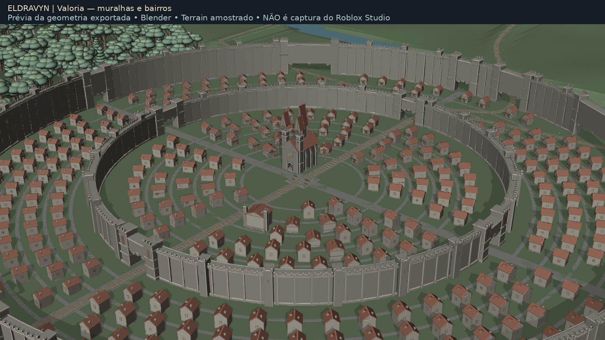
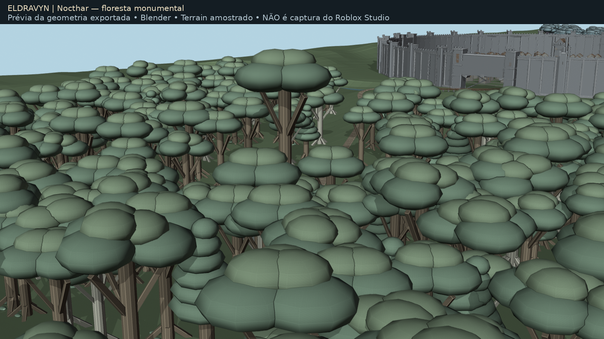
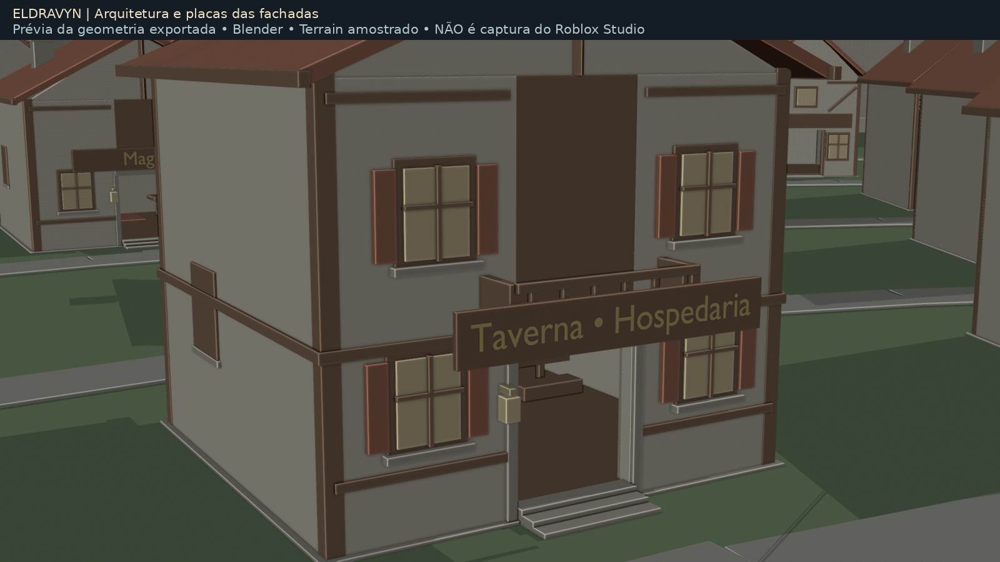
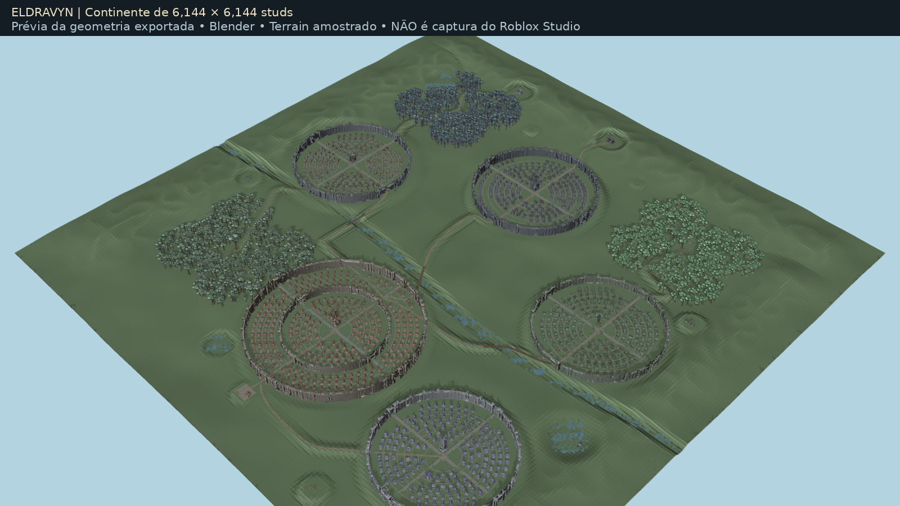

# Eldravyn — continente monumental

[Baixar o Place com geradores](https://raw.githubusercontent.com/fernando-vaccari/RPG-Roblox/refs/heads/codex/eldravyn-monumental-20261029/delivery-map/monumental/Eldravyn-Monumental.rbxlx). Se abrir como texto, use botão direito → **Salvar link como…** e mantenha `.rbxlx`.

Continente de **6.144 × 6.144 studs**, 1.054 lotes urbanos, cinco cidades, muralhas de 80–104 studs, dois anéis em Valoria e 1.440 árvores planejadas em três florestas. Casas medievais com placas em português, telhados, madeira, janelas, chaminés e variações. A geometria contém 92.702 BaseParts; o mapa anterior está preservado.

Abra numa nova cópia no Roblox Studio. Fora do Play, execute na Command Bar:

```lua
require(game.ServerStorage.MedievalWorldgen.WorldGenerator).PrepareStudio()
```

As construções já estão no arquivo. O comando completa o **Terrain nativo** uma vez (2.304 chunks); aguarde o Output concluir, salve a cópia e depois clique Play. O gerador não é executado a cada entrada de jogador. O cenário é uma entrega de mapa; os sistemas completos do RPG continuam preservados nos projetos legados do repositório.

[Guia, detalhes e testes](../../docs/MONUMENTAL_MAP.md) · [Manifesto](MANIFEST.json) · [Verificações](VALIDATION.json) · [SHA-256](SHA256SUMS.txt).

## Prévias da geometria

As imagens abaixo são renderizações **offline no Blender**, com relevo amostrado. Não são capturas nem testes de desempenho do Roblox Studio. As cores, materiais, fontes e iluminação no Studio podem diferir. O [relatório](previews/PREVIEW_REPORT.json) registra a origem e as limitações.






## Validação e segurança

Compilação Luau, testes puros/simulados, referências XML, correspondência de 40 scripts e hashes verificados. **Roblox Studio e antivírus não foram executados.** Física, streaming, aparência final e desempenho no Ryzen 7 5700U/12 GB ainda precisam de teste real. Comece em LOW.

O alerta anterior `Trojan:Script/Ulthar.A!ml` permanece sem causa determinada. Este arquivo é uma nova revisão artística, não uma liberação do Defender. Se o Defender bloquear, não libere nem crie exclusões: encaminhe o arquivo/hash ao [portal oficial da Microsoft](https://www.microsoft.com/en-us/wdsi/filesubmission).
