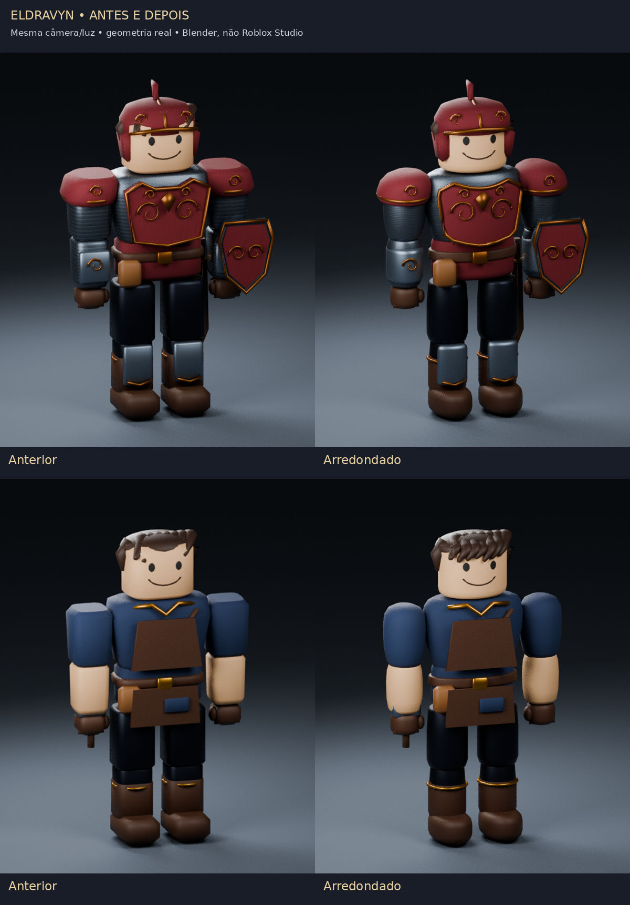
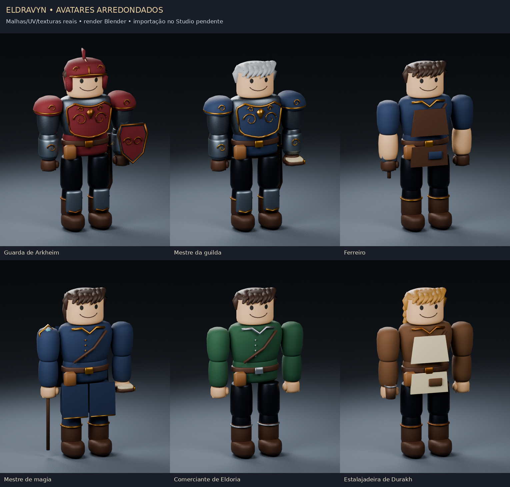

# Eldravyn — avatares mais arredondados

Revisão `rounded-1`: cabeça cilíndrica com bordas curvas, tronco oval, braços/pernas com seções elípticas, mãos/botas com transições curvas e ombreiras abauladas. O peitoral tem volume convexo, com os relevos acompanhando a superfície. A franja foi ajustada ao novo formato da cabeça.

Continuam sendo **66 NPCs temáticos e 14 tipos de inimigo**, com os mesmos nomes, IDs, juntas, posições e funções. As formas de livros, escudos e ferramentas mantêm os detalhes próprios desses objetos. Não há mudanças de mapa, economia, missões, combate ou salvamento nesta revisão.



São renders das malhas reais com a mesma câmera/iluminação, fora do Roblox Studio. Não são capturas do jogo ou validação de FPS.

## Downloads

| Arquivo | Conteúdo |
| --- | --- |
| [Integrador arredondado `.rbxmx`](../../delivery-npcs/avatar-rounded/Eldravyn-Rounded-Avatar-Integration.rbxmx?raw=1) | Registro, aplicação e rollback da revisão `rounded-1` |
| [Valoria `.fbx`](../../assets/avatars-rounded/source/Eldravyn_Valoria.fbx?raw=1) | 24 NPCs |
| [Arkheim/Eldoria `.fbx`](../../assets/avatars-rounded/source/Eldravyn_North.fbx?raw=1) | 20 NPCs |
| [Durakh/Asterion `.fbx`](../../assets/avatars-rounded/source/Eldravyn_South.fbx?raw=1) | 20 NPCs |
| [Dungeons e inimigos `.fbx`](../../assets/avatars-rounded/source/Eldravyn_Dungeons.fbx?raw=1) | Dois administradores e 14 tipos de inimigo |

O atlas/PBR anterior é reutilizado e vem embutido nos FBX. Se necessário, os [três PNG originais](../../assets/avatars/textures) continuam disponíveis. [SHA-256 e manifesto](../../delivery-npcs/avatar-rounded/README.md) · [Testes e mudanças](TESTS.md).

## Instalação no Studio Windows 11

As malhas são geradas por código, mas **precisam ser importadas/publicadas pelo Importador 3D na conta/grupo dono do jogo** para receber os IDs reais. A máquina utilizada não tem Studio nem publicação Roblox; não foram inventados IDs. O integrador sozinho não contém meshes online.

1. Abra uma cópia salva do Place que já tenha os NPCs Stage 2 ou V2. Pare Play/Run.
2. **Se já aplicou a versão Avatar anterior**, reverta-a usando seu pacote anterior, antes de aplicar esta revisão:

```lua
require(game.ServerStorage.EldravynAvatarUpgrade.Upgrade).Rollback()
```

Não execute esse comando se só instalou Stage 2/V2. O novo pacote rejeita uma revisão Avatar diferente já aplicada, sem sobrescrever seu backup.

3. Importe o novo `.rbxmx` para `ServerStorage`. O nome deve ser **`EldravynRoundedAvatarUpgrade`**. Mantenha o pacote anterior separado para sua reversão, se necessário.
4. Importe cada novo FBX pelo **Import 3D**, preservando os nomes, as peças separadas, suas posições relativas e **cinco marcadores**: `ELDRAVYN_CAL_O/X/Y/Z` e `ELDRAVYN_ART_rounded_1`. Não mescle todas as peças por material. Finalize a importação/publicação dos meshes e texturas na sua conta/grupo.
5. Selecione no Explorer o Model contendo os objetos de **um arquivo FBX** e execute em Edit:

```lua
require(game.ServerStorage.EldravynRoundedAvatarUpgrade.RegisterImported).Apply(game:GetService("Selection"):Get()[1])
```

Repita para os quatro grupos. O esperado é **24 + 20 + 20 + 16 = 80 modelos registrados**. O marcador de revisão impede misturar os FBX antigos com esta entrega.

6. Confira os registros:

```lua
require(game.ServerStorage.EldravynRoundedAvatarUpgrade.RegisterImported).Report()
```

`Missing` deve estar vazio. Os clones registrados ficam no pacote em `ServerStorage`; guarde/remova os grandes grupos de importação do Workspace antes de testar desempenho.

Se o Studio não reconhecer metal/rugosidade, publique os três PNG na sua conta e configure os IDs reais **antes** de Apply. Detalhes e exemplo de `SetPBR` no [guia da biblioteca](../avatar-style/README.md); nesta revisão use `EldravynRoundedAvatarUpgrade` como nome do pacote.

7. Aplique a aparência:

```lua
require(game.ServerStorage.EldravynRoundedAvatarUpgrade.Upgrade).Apply()
```

Os mesmos NPCs, Humanoid, Animator, motores, prompts e poses continuam sendo utilizados. Repetir o comando com a mesma revisão retorna `Already`. O serviço de inimigos e seus valores continuam usando a integração visual já implementada; este pacote não inicia combate nem cria spawns.

8. Salve/reabra a cópia e teste aparência, diálogos, patrulhas e poses. Para reverter esta revisão, pare Play e execute:

```lua
require(game.ServerStorage.EldravynRoundedAvatarUpgrade.Upgrade).Rollback()
```

O backup usa `ServerStorage.EldravynAvatarBackupV3`, com `ArtRevision = rounded-1`. Sources personalizados interrompem a reversão automática. Guarde uma cópia do Place antes de instalar ou editar os novos meshes.



[Prévia dos inimigos](previews/inimigos.png). Ossos, pontas de armas e chifres mantêm sua silhueta; os corpos humanoides receberam o novo arredondamento. Lobos, cervo e slime já usam volumes curvos próprios.

## Limites

O número de peças visuais não mudou: 15 por NPC, 990 nos 66 personagens, 1.162 na biblioteca completa. A geometria arredondada aumentou o total fonte para **930.326 triângulos nos 80 modelos**; isso não representa uma única cena renderizada nem uma medição de FPS. Os orçamentos de animação/streaming existentes são preservados, mas o conjunto exige teste no computador/celular do usuário.

Studio, importação/publicação Roblox, permissões, física, renderização do jogo, FPS e Defender não foram executados aqui. O teste de importação/reimportação foi realizado no Blender. Os arquivos Avatar anteriores, Stage 2 e V2 foram preservados, com hashes conferidos.
