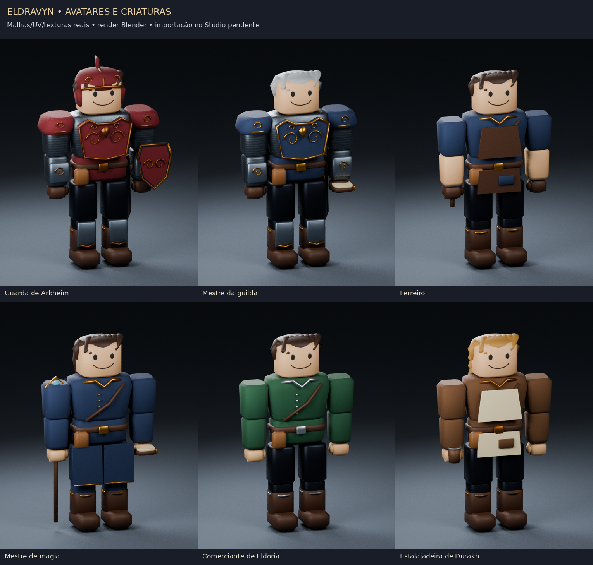
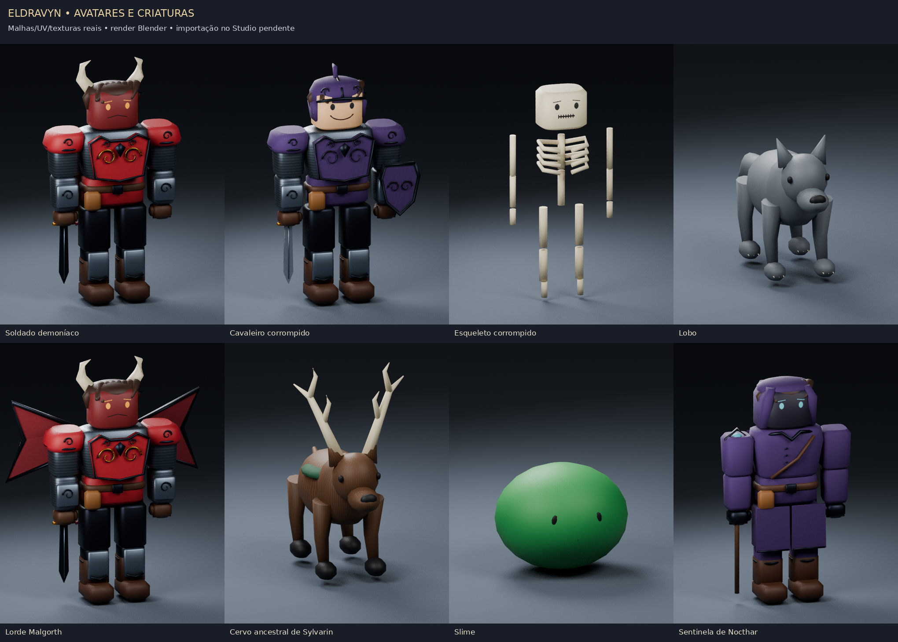

# Eldravyn — personagens no estilo de avatar Roblox

Esta revisão substitui a direção visual V2 por **malhas 3D originais**, cabeça clássica de avatar, rosto aplicado na textura, cabelo modelado, roupas em camadas, cota de malha e armaduras com relevos dourados. A referência enviada orienta proporções e acabamento; não é um asset de catálogo copiado.

Foram produzidos **66 modelos temáticos para os NPCs existentes e 14 modelos de inimigos**. Os nomes/IDs, profissões, cidades, missões e regras de jogo continuam vindo dos catálogos anteriores. Cada NPC tem seu próprio conjunto de malhas, com cores de cidade e adereços da função.



**As imagens são renders das malhas reais no Blender. Não são capturas do Roblox Studio.** Os FBX foram exportados e reimportados para conferir geometria, nomes, UVs e atlas. Importação/publicação no Roblox, animação no engine e FPS ainda precisam ser testados.

## O que baixar

Baixe o integrador e os **quatro FBX**. Os arquivos já contêm texturas embutidas; os três PNG separados servem para configurar os mapas PBR se o Studio não os reconhecer automaticamente.

| Arquivo | Conteúdo |
| --- | --- |
| [Eldravyn-Avatar-Integration.rbxmx](../../delivery-npcs/avatar-style/Eldravyn-Avatar-Integration.rbxmx?raw=1) | Registrador das importações, atualização/reversão e adaptador visual de inimigos |
| [Eldravyn_Valoria.fbx](../../assets/avatars/source/Eldravyn_Valoria.fbx?raw=1) | 24 NPCs de Valoria |
| [Eldravyn_North.fbx](../../assets/avatars/source/Eldravyn_North.fbx?raw=1) | 20 NPCs de Arkheim e Eldoria |
| [Eldravyn_South.fbx](../../assets/avatars/source/Eldravyn_South.fbx?raw=1) | 20 NPCs de Durakh e Asterion |
| [Eldravyn_Dungeons.fbx](../../assets/avatars/source/Eldravyn_Dungeons.fbx?raw=1) | Dois administradores de entrada e os 14 tipos de inimigo |
| [Eldravyn_Color.png](../../assets/avatars/textures/Eldravyn_Color.png?raw=1) | Atlas de cor, tecido, couro, cota de malha e rostos |
| [Eldravyn_Metalness.png](../../assets/avatars/textures/Eldravyn_Metalness.png?raw=1) | Máscara de metal para o atlas |
| [Eldravyn_Roughness.png](../../assets/avatars/textures/Eldravyn_Roughness.png?raw=1) | Rugosidade para o atlas |

[Manifesto e SHA-256](../../delivery-npcs/avatar-style/README.md) · [Catálogo dos modelos](../../assets/avatars/source/CATALOG.json) · [Testes](TESTS.md) · [Alterações](CHANGES.md)

## Etapa necessária no Studio

**Os FBX precisam ser importados/publicados na conta proprietária pelo Importador 3D do Roblox Studio.** Essa operação cria os IDs reais de mesh e textura e trata as permissões da Experience. Não há Roblox Studio ou sessão de publicação Roblox nesta máquina; nenhum ID foi inventado. O `.rbxmx` é o integrador e não contém malhas publicadas nem modifica NPCs antes de registrar os arquivos importados.

A biblioteca usa peças de malha ligadas ao rig R15 existente por `WeldConstraint` e `Motor6D`; não depende de EditableMesh em produção, catálogos pagos ou um plugin de terceiros. Os modelos FBX não incluem scripts, IA, perfil de jogador ou skinning por pesos. A ligação ao rig é feita pelo integrador depois da importação.

## Instalar no Windows 11

1. Abra seu Place **já contendo a instalação NPC Stage 2 ou V2** e salve uma cópia de teste. Pare Play/Run. Não gere o continente novamente.
2. Importe `Eldravyn-Avatar-Integration.rbxmx` com **Insert from File…** e coloque somente o modelo `EldravynAvatarUpgrade` em `ServerStorage`. O pacote chega passivo, sem scripts habilitados.
3. Pelo **Import 3D / Importador 3D**, importe cada um dos quatro FBX na **conta/grupo proprietário da Experience**. Preserve os nomes e as posições relativas das peças. Mantenha as malhas separadas: não use uma opção de mesclar toda a cena/por material. Os quatro pequenos marcadores `ELDRAVYN_CAL_O/X/Y/Z` devem ser mantidos até o registro; eles compensam unidade, orientação e posição de importação.
4. Confira o resultado na prévia do importador e finalize a importação/publicação. Os materiais devem mostrar o atlas de cor. Se a importação gerar vários modelos, agrupe os objetos de **um arquivo FBX** em um Model. Selecione esse Model no Explorer e execute na Command Bar, ainda em Edit:

```lua
require(game.ServerStorage.EldravynAvatarUpgrade.RegisterImported).Apply(game:GetService("Selection"):Get()[1])
```

Repita a seleção/comando para cada arquivo. O resultado esperado é **24 + 20 + 20 + 16 = 80 modelos registrados**. A operação clona somente geometria/material auditados para `ServerStorage.EldravynAvatarUpgrade.ImportedTemplates`. Nenhum NPC é alterado nessa etapa. Scripts no grupo, marcadores faltantes, nomes alterados, meshes sem URI publicada ou atlas ausente interrompem o registro.

5. Confira os registros:

```lua
require(game.ServerStorage.EldravynAvatarUpgrade.RegisterImported).Report()
```

O campo `Missing` deve estar vazio. Depois, guarde/remova da cópia os grandes grupos FBX que ficaram no Workspace após a importação; as cópias necessárias já estão em `ServerStorage`. Não deixe 80 personagens de importação sobrepostos ao mapa para medir desempenho.

6. **Se os mapas PBR não vierem automaticamente:** publique os três PNG como imagens na mesma conta/grupo e copie os IDs reais. Antes de aplicar a atualização, execute o comando abaixo, substituindo os três textos entre `<…>` por IDs reais. Eles são instruções de preenchimento, não IDs existentes:

```lua
require(game.ServerStorage.EldravynAvatarUpgrade.RegisterImported).SetPBR(
    "rbxassetid://<ID_REAL_COLOR>",
    "rbxassetid://<ID_REAL_METALNESS>",
    "rbxassetid://<ID_REAL_ROUGHNESS>"
)
```

7. Para atualizar os NPCs existentes:

```lua
require(game.ServerStorage.EldravynAvatarUpgrade.Upgrade).Apply()
```

O esperado é **66 NPCs atualizados** e a biblioteca de inimigos instalada. Os mesmos Model, Humanoid, Animator, 15 motores e prompts continuam em uso. O integrador oculta as peças corporais antigas e conecta as malhas às peças correspondentes, respeitando pose e escala. Não reposiciona os NPCs ou muda construções/terreno.

8. Salve/reabra a cópia e teste Play com o [roteiro manual](TESTS.md). Não foi possível validar esses passos no Roblox Studio neste ambiente. Caso a importação difira dos nomes ou materiais esperados, pare antes de `Apply()` e registre o Output; não remova a proteção para forçar o registro.

## Temas e inimigos

Os guardas têm heráldica por cidade, capacetes, cota de malha, escudo, bracadeiras e grevas. Mestres de guilda usam armadura cerimonial, capa, livro e espada embainhada. Ferreiros têm avental e martelo; comerciantes, bolsas e roupas de viagem; estalajadeiros, avental e caneca; magos/estudiosos, mantos, livro e cajado conforme o papel. Curandeiros, banqueiros, guias, artesãos, fazendeiros, moradores e administradores mantêm temas próprios e seus diálogos originais.

Os 14 tipos existentes são: bandido, lobo, lobo sombrio, slime, esqueleto corrompido, soldado demoníaco, guardião das sombras, cavaleiro corrompido, Malgorth, cervo ancestral de Sylvarin, sentinela de Nocthar, regente do reino caído, parceiro de treino e arauto de Véspera. Lobos e cervo têm silhueta quadrúpede e juntas visuais próprias; o slime tem geometria e movimento de deformação simples. Os demais usam o esqueleto R15.



A instalação disponibiliza `ServerStorage.EldravynEnemyAvatarLibrary`. O `EnemyService` existente recebe somente um ponto de escolha de factory visual; dano, vida, IA, alvos, recompensas, participantes, andares e spawns continuam no serviço original. A instalação **não cria spawns nem ativa o combate** na etapa NPC. Na cópia em que o combate existente já está ativo, novos inimigos usam essa biblioteca. Não há uma segunda IA ou novo DataStore.

Para inspecionar uma criatura em Edit, depois de aplicar:

```lua
require(game.ServerStorage.EldravynAvatarUpgrade.Upgrade).PreviewEnemy("Demon")
```

O modelo fica em `Workspace.EldravynAvatarPreviews`, ancorado em `(0, 20, 0)`, para selecionar e enquadrar com **F**. Não está registrado na IA e não concede loot. Remova essa pasta de demonstração antes de usar a cópia como jogo.

## Reverter

Pare Play/Run e execute:

```lua
require(game.ServerStorage.EldravynAvatarUpgrade.Upgrade).Rollback()
```

O backup é `ServerStorage.EldravynAvatarBackupV3`. Sobre V2, restaura os mesmos adornos/visuais V2 guardados. Sobre Stage 2, também reverte os controladores V2 instalados pelo pacote. Recoloca o objeto `EnemyService` anterior, remove bibliotecas/cliente Avatar e preserva NPCs, identidades, posições e dados. Registros de auditoria ficam renomeados no Storage.

Use **este rollback Avatar** enquanto a camada Avatar estiver instalada. Não acione separadamente o rollback V2 antigo. Sources personalizados depois da instalação interrompem a reversão automática; exporte suas alterações ou use a cópia salva antes de instalar. Edições manuais nos novos meshes pertencem à camada removida: guarde uma cópia antes de fazê-las.

## Limites reais

Não foi feita publicação de meshes/imagens na sua conta; a importação acima é indispensável. O pacote bloqueia aplicação sem os arquivos registrados. As animações continuam procedurais, sem clips publicados; cabelos e capas são geometria fixa ligada ao corpo, sem simulação de tecido. São modelos estilizados originais, sem afirmar escultura manual profissional, face animada ou fidelidade idêntica à imagem enviada.

Há 990 meshes visuais nos 66 NPCs (15 por personagem); a biblioteca fonte completa tem 1.162 meshes, sem contar os marcadores. O cliente anima até dez inimigos próximos com scheduler compartilhado; o orçamento NPC V2 permanece. Isso não é medição de FPS. O mapa monumental continua sendo o maior componente de desempenho; teste o conjunto no Ryzen 7 5700U/12 GB e em celular.

Studio, rede/asset permissions, física, FPS e Defender reais não foram executados. Os alertas anteriores de antivírus continuam sem veredicto. Nenhuma alteração foi feita para tentar eliminar detecção.
