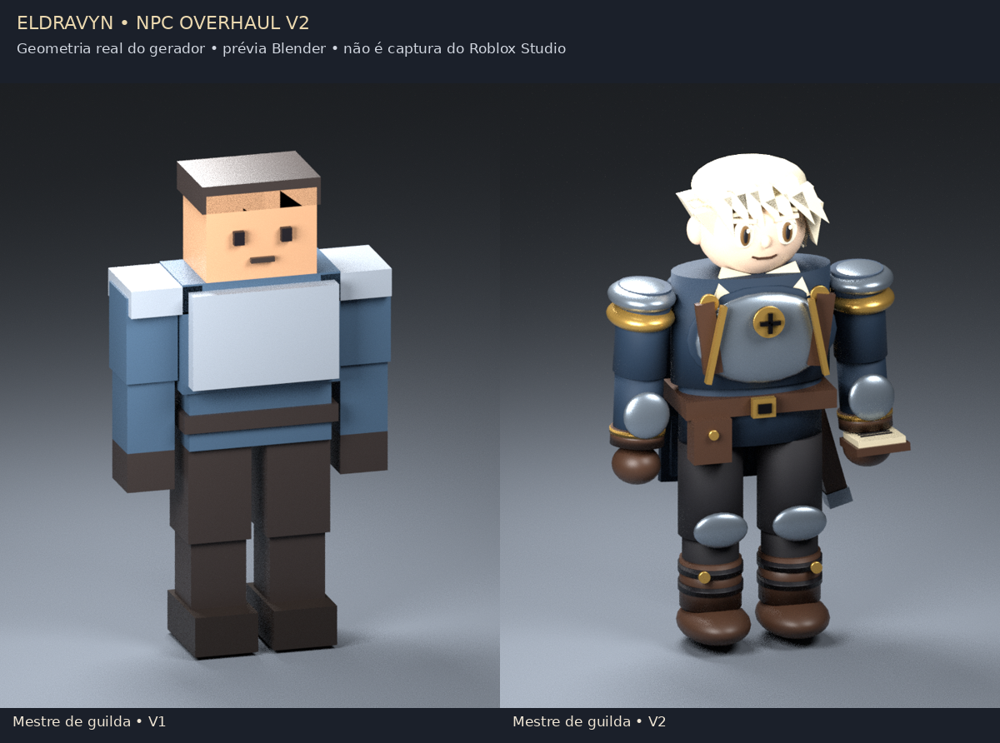
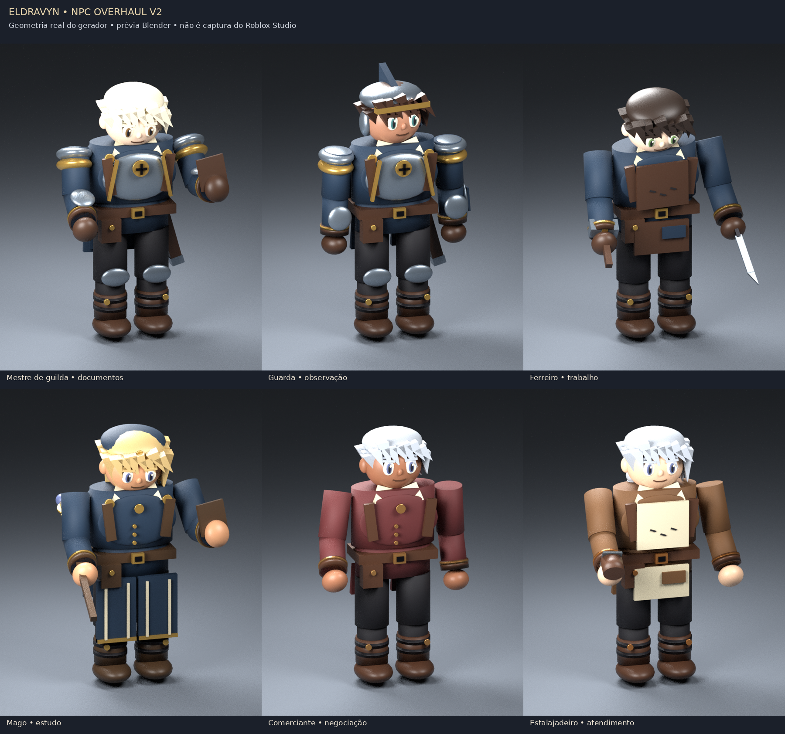

# Eldravyn — NPC Overhaul V2

Atualização aditiva para os **66 NPCs da instalação Stage 2**. O mapa, terreno, construções, posições iniciais, identidades, diálogos, menus, serviços, preços, missões e dados anteriores são preservados. Os mesmos Model, Humanoid, Animator, Motor6D e ProximityPrompt continuam sendo usados.

[Baixar o atualizador `.rbxmx`](../../delivery-npcs/visual-v2/Eldravyn-NPC-Overhaul-V2.rbxmx?raw=1) · [Testes executados e roteiro Studio](TESTS.md) · [Arquivos alterados](CHANGES.md) · [Assets e limites visuais](ASSETS.md)



Estas imagens usam as peças e poses geradas pelo código, renderizadas no Blender. **Não são capturas do Roblox Studio.** Iluminação, materiais, física e resultado no engine precisam de revisão no Studio. Não há meshes profissionais ou texturas pintadas nesta entrega.

## Instalar no Windows 11

1. Abra **seu Place atual que já contém os NPCs Stage 2**. Use **Salvar como / Save to File As** para criar uma cópia de teste antes da atualização. Pare Play/Run. A cópia local de aproximadamente 383 MB mencionada anteriormente não foi fornecida; o pacote atualiza os objetos existentes nela, sem substituí-la por outro Place.
2. Baixe `Eldravyn-NPC-Overhaul-V2.rbxmx`. Se o navegador mostrar XML, use **Salvar link como…** e mantenha a extensão `.rbxmx`, sem acrescentar `.txt`. O arquivo é um modelo de atualização, não um `.rbxlx` para abrir como jogo novo.
3. No Explorer do Studio, selecione `ServerStorage` e use **Insert from File… / Inserir do arquivo…**. Escolha o arquivo. Se o Studio inserir o modelo em `Workspace`, mova **somente `EldravynNPCVisualUpgradeV2`** para `ServerStorage`. Mantenha uma única cópia desse pacote.
4. Confira a estrutura abaixo. O atualizador aborta se faltar uma dependência ou se encontrar scripts incompatíveis; não reinstala NPCs ou o mundo.

```text
Workspace
  GeneratedWorld                  ← mapa atual
  EldravynNPCs                    ← NPCs já instalados
ServerStorage
  EldravynNPCPackage              ← pacote anterior, preservado
  EldravynNPCVisualUpgradeV2      ← novo pacote
    NPCVisualUpgrade
ReplicatedStorage
  EldravynNPC
ServerScriptService
  EldravynNPC
StarterPlayer / StarterPlayerScripts
  EldravynNPCClient
```

5. Abra **View / Exibir → Command Bar / Barra de comandos**, no modo de edição. Para inspecionar a instalação sem modificá-la:

```lua
require(game.ServerStorage.EldravynNPCVisualUpgradeV2.NPCVisualUpgrade).Report()
```

6. Para aplicar a atualização:

```lua
require(game.ServerStorage.EldravynNPCVisualUpgradeV2.NPCVisualUpgrade).Apply()
```

O resultado esperado na base entregue é `66 NPCs atualizados no lugar`. O backup fica em `ServerScriptService.EldravynNPCVisualBackupV2`. A versão visual aparece em `Workspace.EldravynNPCVisualVersion = 2` e no atributo `NPCVisualVersion = 2` de cada personagem. Executar `Apply()` novamente apenas informa que já foi aplicado.

7. **Salve a cópia**, feche/reabra e execute Play. Teste a lista em [TESTS.md](TESTS.md) antes de usar essa cópia em produção. Preserve o backup lógico e seu arquivo anterior.

Não é preciso gerar o continente novamente. Esta atualização **não utiliza** `GenerateNewWorld`, `PrepareStudio` nem `Installer.Install`. Se o seu Place já apresentar `TerrainPending`, isso é uma pendência da versão do mapa: o V2 não gera terreno e o bootstrap anterior continua impedindo o início nessa condição. Use a sua cópia já preparada; não altere o mapa para instalar os visuais.

## Reverter

Pare Play/Run e execute em Edit:

```lua
require(game.ServerStorage.EldravynNPCVisualUpgradeV2.NPCVisualUpgrade).Rollback()
```

O comando restaura propriedades corporais, adornos e os três objetos de script originais; remove apenas a camada V2 registrada. NPCs, posições, prompts e sistemas de dados são mantidos. O registro é renomeado para `EldravynNPCVisualRollback_<GUID>` para auditoria. Depois, salve e reabra a cópia.

Se você modificar os Sources dos adaptadores ou bibliotecas V2 depois do upgrade, a reversão automática **interrompe antes de apagar sua customização**. Exporte essas mudanças e restaure as fontes V2 dos snapshots do backup, ou retorne ao arquivo salvo antes da instalação. Guarde também uma cópia antes de editar manualmente os adornos em `NPCV2Visuals`: essa pasta pertence à camada removida no rollback.

Se `Apply()` detectar um Source V1 personalizado, nenhum NPC é alterado. A adaptação precisa ser revisada nesse script; não remova a proteção para forçar a instalação. Leituras de `Source` exigem a Command Bar do Studio em Edit; comandos de cliente, servidores publicados e Play/Run não são suportados para migração.

## O que foi implementado

- **25 papéis existentes:** uniformes e acessórios por profissão; paletas das cinco cidades e das duas entradas de dungeon. Rosto em camadas, cabelo em mechas, colarinhos, mangas, botas, bolsas, armaduras, capas, livros, martelos, escudos, espadas embainhadas, cajados e utensílios conforme o papel.
- **R15 preservado:** 15 motores e suas conexões; nenhuma mudança nos CFrames das juntas. Corpos nativos recebem acabamentos e volumes arredondados ligados às mesmas peças. As propriedades anteriores ficam no backup.
- **15 estados de pose:** idle, caminhada, corrida quando há deslocamento compatível, cumprimento, conversa, forja, inspeção, organização, estudo, gesto arcano, negociação, documentos, atendimento, orientação e observação. Transições procedurais com fallback sem IDs de animação.
- **AnimationTrack opcional:** carga/cache pelo Animator existente, prioridades e fade; não recria tracks por frame. Suspende o controlador diante de Animate/tracks externos, morte, assento ou ragdoll. Remove o deslocamento adicional de atenção antes da próxima amostragem do Animator.
- **Atenção:** percepção até 22 studs, campo frontal de 80° para cada lado, cabeça limitada a 44° horizontal/20° vertical, torso a 11°. Interlocutor ativo tem prioridade e permanece estável quando há dois jogadores. Cumprimentos têm intervalo de 14 segundos.
- **Comportamento:** comerciantes/magos/ferreiros permanecem nos postos. Guardas e papéis ambientais elegíveis fazem pequenos percursos de 2,5 studs, retornam à origem e pausam para conversar. Um scheduler de 0,2 s verifica piso, obstáculos e outros NPCs; no máximo quatro deslocamentos simultâneos. Piso incompatível gera aviso e bloqueia a patrulha sem mover o personagem.
- **Cliente limitado:** até 12 NPCs em detalhe completo no desktop ou 8 em touch, mais 8 reduzidos; atualização a 30/20/6 Hz. Distâncias de 48/100 studs, detalhes menores até 42 studs, no máximo três atores com efeito arcano e **zero ParticleEmitters**. Cache e limpeza de conexões/streaming.

Esses valores são orçamentos implementados, **não medições de FPS**. Os 66 NPCs receberam 5.467 adornos, máximo 100 por personagem, além dos corpos originais. A geometria é criada uma vez no editor; jogadores entrando não recriam mapa ou visuais.

## Configurar

Após aplicar, `ReplicatedStorage.EldravynNPCVisualV2.NPCVisualConfig` contém limites, frequências e IDs opcionais. Os IDs chegam vazios. Somente configure animações R15 publicadas por você ou autorizadas para a Experience e para este rig; teste todas as juntas, privilégios e transições. Não há compra ou ferramenta paga obrigatória. Faça mudanças com Play parado e reinicie o teste para recarregar os módulos.

`NPCAppearanceConfig` define paletas e profissões; a geometria já aplicada não se regenera ao editar esse módulo. Para redesenhar uma aparência, trabalhe na cópia: reverta, ajuste `Runtime/Shared/NPCAppearanceConfig` no pacote, salve/reabra o Studio para limpar o cache de `require` e reaplique. Não altere `NPCConfig` ou `PlacementConfig` para mudar apenas a aparência.



## Limitações verificáveis

Roblox Studio, Defender, rede real, permissões reais de animação e FPS no Ryzen 7 5700U/celular não foram executados neste ambiente Linux. A validação final no engine permanece pendente. A causa dos alertas anteriores do Defender continua indeterminada; esta atualização funcional não é uma tentativa de evitar a detecção nem uma declaração de segurança. Se houver novo bloqueio, mantenha a proteção ativa e encaminhe arquivo/hash à [Microsoft](https://www.microsoft.com/en-us/wdsi/filesubmission).
